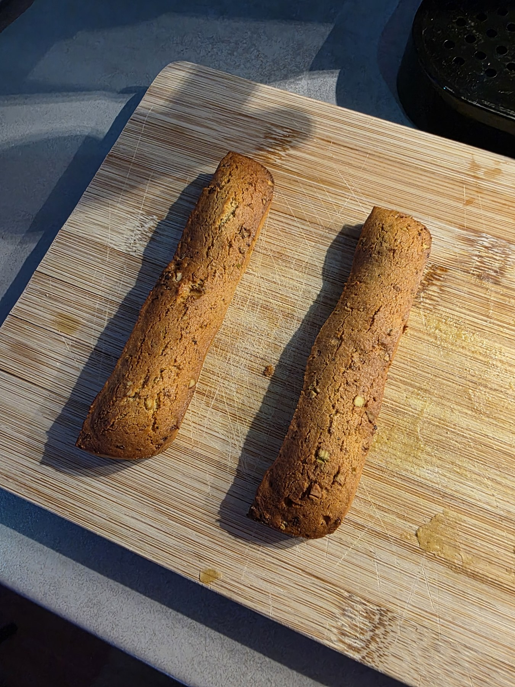
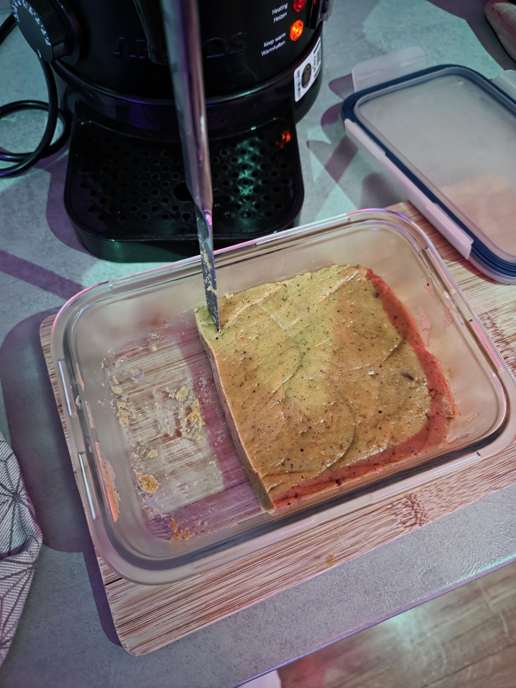
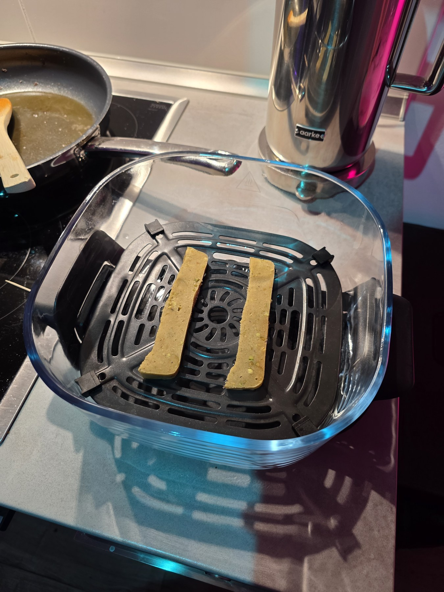
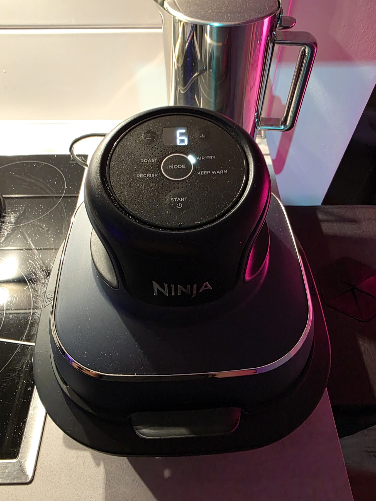
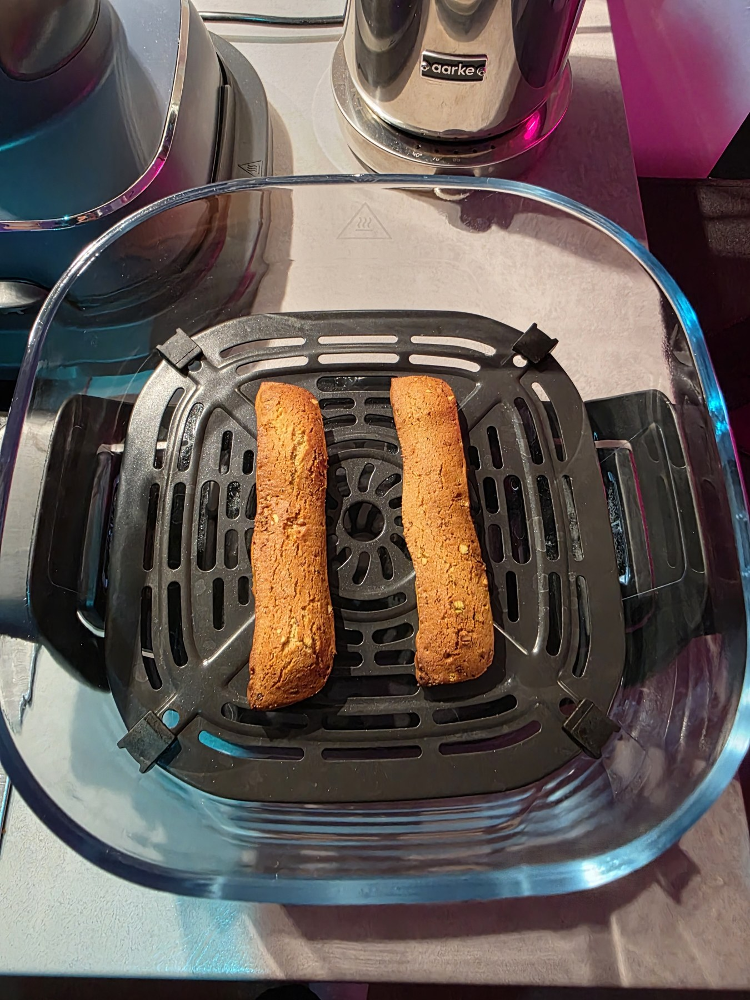
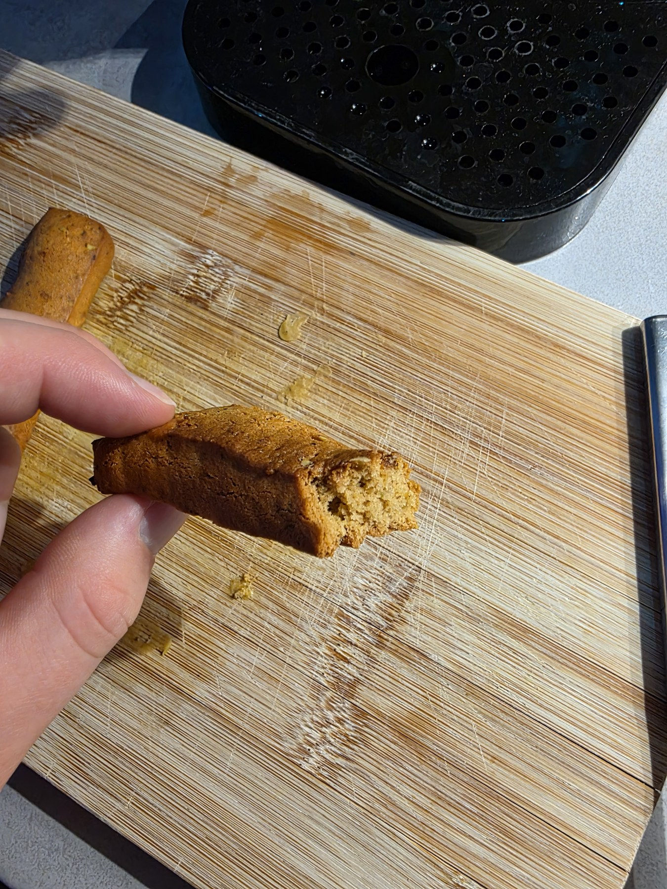

# Saffron Pistachio Gingerbread

Honey-spiced gingerbread with saffron, pistachios, rosewater, and warm Lebkuchen spice. Inspired by the flavors of Persian bastani sonnati, baked as simple strips or cookies.

**[Deutsches Rezept →](README.de.md)**

## My preferred method: air fryer

I baked this batch on October 15, 2026. Both the oven version, at about **12 minutes**, and the air fryer version, at about **6 minutes**, tasted perfect to me. I prefer the air fryer because it is faster for a small batch.

I used the **Air Fry mode on the Ninja shown below**, with a **6-minute timer**. My unit did not offer a temperature setting, so I did not enter one. The operating temperature is not recorded. These are the settings for my appliance, rather than a universal temperature-and-time combination for every air fryer.

[See the appliance and settings](images/air-fryer-settings.jpg).

## At a glance

- **Yield:** approximately 40–50 small cookies; an estimate, depending on size. The photographed batch uses long strips.
- **Chilling:** at least 8 hours, preferably overnight.
- **Dough thickness:** 5–6 mm in the written recipe; the photographed strips were not measured.
- **Air fryer:** Air Fry mode, about 6 minutes on the pictured unit.
- **Oven:** 180°C conventional / 160°C fan in the written recipe; about 12 minutes in my bake. The actual oven temperature was not separately recorded.

## Ingredients

### Dough

| Ingredient | Amount |
| --- | ---: |
| Mild honey, preferably acacia | 250 g |
| Fine granulated sugar | 100 g |
| Unsalted butter | 90 g |
| Plain wheat flour, German Type 405 | 450 g |
| Unsalted pistachios, finely ground | 50 g |
| Unsalted pistachios, chopped | 40 g |
| Egg, European size M | 1 |
| Saffron threads | 0.3 g |
| Hot water for the saffron | 2 tbsp |
| Culinary rosewater, regular strength | 1 tsp |
| Lebkuchen spice blend | 2 tsp |
| Vanilla extract | ½ tsp |
| Fine salt | ¼ tsp |
| Food-grade potash (Pottasche) | 4.5 g |
| Water to dissolve the potash | 1 tbsp |

Use a ready-made Lebkuchen spice blend for the warm cinnamon-spice note. This version has no separately measured cinnamon or cardamom. Use culinary rosewater rather than cosmetic rosewater or concentrated extract. Use baking Pottasche as listed; this version does not use baking soda.

### Optional thin rosewater glaze

- 100 g powdered sugar
- ½ tsp culinary rosewater
- About 1–2 tbsp water, added gradually
- 25 g finely chopped pistachios for topping

You need **115 g pistachios total** with the topping, or **90 g without it**. The glaze is part of the saved recipe; the photos show the strips without it.

## Method

1. **Infuse the saffron.** Grind about three-quarters of the threads with a small pinch of the measured sugar. Lightly crush the remaining threads. Add all the saffron to 2 tbsp hot water, cover, and steep for **20 minutes**. Keep the threads in the infusion.
2. **Warm the honey mixture.** Gently heat the honey, remaining sugar, and butter, stirring until combined and the sugar has mostly dissolved. Do not boil. Let it cool to lukewarm, then mix in the saffron infusion, rosewater, vanilla, and egg.
3. **Make the dough.** Dissolve the Pottasche completely in 1 tbsp water. Mix the flour, ground pistachios, Lebkuchen spice, and salt. Add the honey mixture, dissolved Pottasche, and chopped pistachios. Mix into an even, slightly tacky dough. Cover and refrigerate for **at least 8 hours**, preferably overnight.
4. **Shape.** Let the dough soften at room temperature for **20–30 minutes**. Roll between sheets of baking paper to **5–6 mm thick**. Cut into strips or cookies. Exact strip dimensions from the photographed bake were not recorded.
5. **Bake using either method below.** Start with a small batch to find the timing for your appliance and piece size. Look for set edges and a lightly browned surface, with the center still slightly soft. Let the pieces cool before judging their final texture.
6. **Glaze, if wanted.** Cool completely. Mix powdered sugar and rosewater, then gradually add enough water for a thin glaze. Brush on lightly, sprinkle with pistachios, and let dry.
7. **Store.** Once cool and any glaze is dry, store airtight. Try them again the next day to see how the texture and flavor develop.

### Air fryer, preferred for small batches

Place the pieces in a single layer on the crisper plate, with room between them. On the Ninja pictured here, select **Air Fry** and set **6 minutes**. No temperature was entered. Check the first batch as it cooks and adjust the time to your appliance, thickness, and browning.

The reported six minutes is cooking time for a small batch, not preparation time or the time required to cook all the dough. Preheating and turning were not recorded for this bake.

### Oven alternative

Preheat to **180°C conventional / 160°C fan**, as specified in the written recipe. Arrange on a lined baking sheet with about **3 cm between pieces**. Bake one tray at a time, checking from **9 minutes**. My successful oven batch took about **12 minutes**; its actual temperature was not separately recorded.

## Photos from my bake

| Chilled dough | Before air frying |
| --- | --- |
|  |  |

| Appliance and settings | Finished strips |
| --- | --- |
|  |  |

### A look inside

The broken edge gives a closer look at the crumb.

Photos by Kian, October 15, 2026. Public copies are resized and stripped of embedded metadata; the originals are preserved separately.

## Recipe history and inspiration

This is my saffron-pistachio adaptation, developed with Codex, rather than an unchanged copy of either source:

- [Einfach Backen: Lebkuchen-Plätzchen](https://www.einfachbacken.de/rezepte/lebkuchen-plaetzchen-schnelles-rezept-zum-ausstechen), the starting point for honey dough and overnight chilling.
- [Cooking With Ayeh: Bastani Sonnati](https://cookingwithayeh.com/persian-ice-cream-bastani-sonnati/), the flavor reference for saffron, pistachios, and rosewater.

The first saved adaptation, dated October 6, used ½ tsp cardamom and 1 tsp baking soda. The revised recipe used for this bake replaces those with **2 tsp Lebkuchen spice and 4.5 g Pottasche dissolved in 1 tbsp water**. The quantities above follow that revised version. The first successful taste report and photos were added on October 15, 2026.
